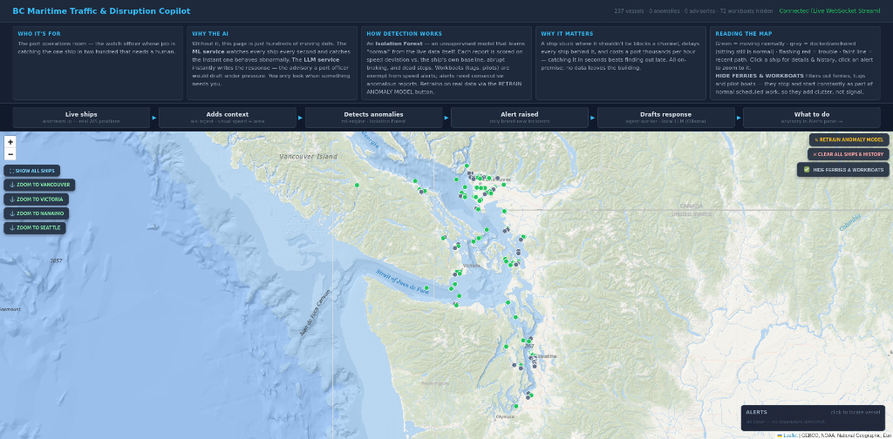
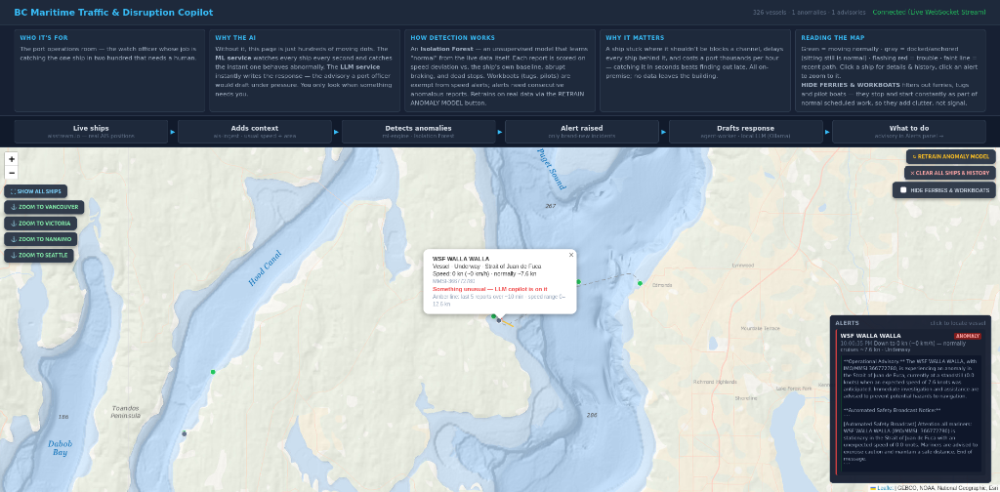
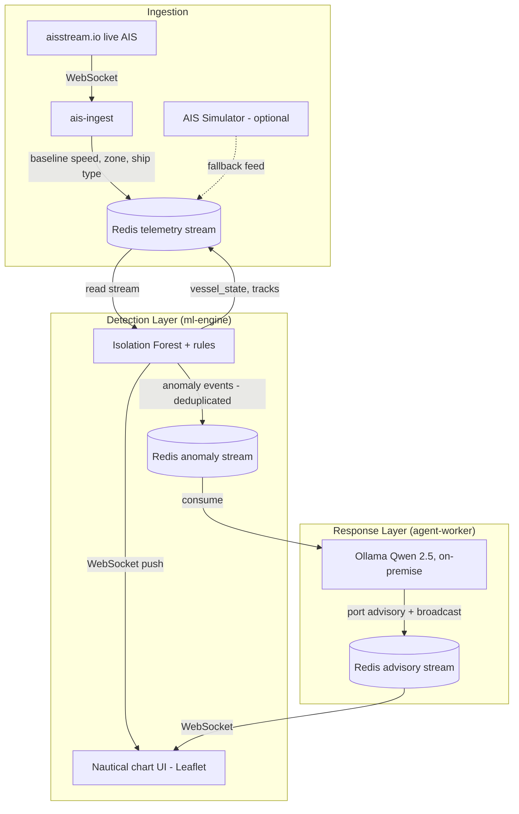

# BC Maritime & Port Operations Disruption Copilot

An event-driven, containerized AI system that watches **live maritime traffic** in the
Salish Sea (Olympia / Puget Sound through the Strait of Georgia), detects anomalous
vessel behavior with machine learning, and autonomously drafts port-operations
advisories with a local LLM — all streamed in real time to an interactive
nautical-chart dashboard.

Two AI layers, no human in the loop, no cloud: an **unsupervised anomaly model**
(Isolation Forest) scores every AIS position report against each vessel's own
behavioral baseline, and an **Ollama LLM agent** (Qwen 2.5) turns each detection
into a written operational advisory and safety broadcast.

---

## Business Value Proposition

Maritime supply chains face massive financial friction from unexpected navigational
delays, channel bottlenecks, and coordination lag between vessels, pilots, and port
authorities:

* **Eliminating Demurrage Costs:** real-time anomaly detection flags unplanned stops
  or fairway drift instantly, preventing cascading berth scheduling conflicts that
  cost thousands of dollars per hour.
* **Proactive Exception Handling:** shifting operations from reactive firefighting to
  autonomous event-driven triage via a local LLM agent that drafts immediate port
  advisories and safety broadcasts.
* **Data Sovereignty & Edge Privacy:** fully self-hosted architecture — vessel data
  never leaves local infrastructure.
* **You only look when it matters:** detection filters hundreds of vessels down to
  the handful that need a human, and the first draft of the response is already written.

---

## Dashboard Preview



*A live anomaly: the WSF WALLA WALLA dropped to 0 kn in the Strait of Juan de Fuca —
the ML service flagged it within seconds and the LLM agent drafted the operational
advisory shown in the Alerts panel.*



---

## System Architecture



### Services

| Service | Role |
|---|---|
| `ais-ingest` | Subscribes to aisstream.io, enriches each report with a per-vessel rolling speed baseline, zone label, ship type and IMO, writes to `maritime_telemetry_stream` |
| `ml-engine` | FastAPI + Isolation Forest detection, serves the dashboard/WebSocket, REST API, model training (`train.py`) |
| `agent-worker` | Consumes `maritime_anomaly_stream`, prompts the local LLM, publishes advisories to `maritime_advisory_stream` |
| `redis` | Streams, vessel state (`vessel_state:*`), tracks (`vessel_track:*`), model store (`ml:model*`) — persisted via `./data/redis` bind mount |
| `simulator` | Fake-fleet telemetry fallback (compose profile `sim`) |

## How Detection Works

Each position report is scored on three features:

1. **Speed deviation** — current speed vs. the vessel's own rolling-median baseline (~40 reports). Moored/anchored vessels (baseline < 2 kn) are exempt — sitting still is normal for them.
2. **Acceleration** — abrupt braking rate in knots/minute.
3. **Dead stop** — speed < 2 kn while the vessel's baseline is ≥ 5 kn.

Plus rule overlays:

- **Hazard statuses** (`Aground`, `Not under command`) flag immediately — the vessel is self-reporting an emergency.
- **Workboat exemption** — tugs, towing vessels, pilot boats, port tenders and fishing boats are exempt from *speed* anomalies (they stop and start by profession) but not hazard statuses.
- **Confirmation streak** — 5+ consecutive anomalous reports required, so routine approaches to a dock don't trip alerts.
- **Deduplication** — an event (and LLM call) fires only on the normal → anomaly transition per vessel.

### The model

An **Isolation Forest** trained on real accumulated telemetry via `POST /api/retrain`
or the RETRAIN ANOMALY MODEL button. A global model covers all vessels; vessels with
≥50 stored track points also get **per-vessel models** (`ml:model:{mmsi}`) that learn
their individual behavior. A synthetic-data model is used as fallback until enough
real data exists.

## The Dashboard

- Nautical chart base (Esri Ocean + reference overlay), WebSocket live updates
- Color-coded markers: green = underway, gray = moored/anchored, pulsing red = anomaly, faint trails = recent paths
- **Alerts panel**: each anomaly is a card showing the vessel, what it did, and the LLM-drafted advisory when ready; click to fly to the vessel
- Click any vessel: popup + amber history trace (last ~200 reports, `/api/vessel/{id}/history`)
- Controls: SHOW ALL SHIPS, city zooms (Vancouver/Victoria/Nanaimo/Seattle), RETRAIN ANOMALY MODEL, CLEAR ALL SHIPS & HISTORY, HIDE FERRIES & WORKBOATS filter

## Running It

```bash
cp .env.example .env   # add your aisstream.io key + Ollama host
docker compose up -d --build
```

Dashboard: http://localhost:8090 (host port set by `ML_ENGINE_PORT`)

Requires an [aisstream.io](https://aisstream.io) API key (free) and a local
[Ollama](https://ollama.com) instance with `qwen2.5:14b` pulled. The built-in
simulator works without either: `docker compose --profile sim up -d`.

### API

| Endpoint | Description |
|---|---|
| `GET /` | Dashboard UI |
| `WS /ws` | Live vessel updates + events |
| `POST /api/retrain` | Retrain anomaly models on accumulated real data |
| `GET /api/vessel/{id}/history` | Vessel's stored position/speed track |
| `POST /api/clear` | Erase all vessel state, tracks and metadata |
| `POST /api/speed` | Simulation speed (sim profile only) |

## Project Layout

```
services/
  ais-ingest/    aisstream.io -> enriched telemetry -> maritime_telemetry_stream
  ml-engine/     FastAPI, Isolation Forest, WebSocket dashboard, train.py
  agent-worker/  anomaly stream -> Ollama -> maritime_advisory_stream
  simulator/     fake-fleet fallback (profile: sim)
shared/          pydantic schemas
docs/            screenshots
```

## License

[MIT](LICENSE)
